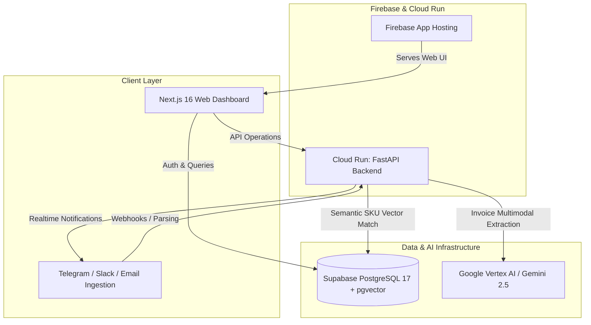

<div align="center">

# 🛡️ PriceShield

**Autonomous AI Supplier Price Tracking, Margin Leakage Detection & Automated Invoice Auditing for Hospitality and Multi-Venue Operators.**

[](https://nextjs.org/)
[](https://fastapi.tiangolo.com/)
[](https://supabase.com/)
[](https://cloud.google.com/)
[](LICENSE)

<br/>

<p align="center">
  <a href="#-architecture">Architecture</a> •
  <a href="#-key-features">Key Features</a> •
  <a href="#-tech-stack">Tech Stack</a> •
  <a href="#-quick-start">Quick Start</a> •
  <a href="#-deployment-guide">Cloud Run Deployment</a> •
  <a href="#-google-auth-setup">Google Auth Setup</a> •
  <a href="#-security--secret-hygiene">Security</a>
</p>

</div>

---

## 📌 Overview

**PriceShield** protects restaurant, hotel, bar, and hospitality profit margins by continuously monitoring vendor pricing on wholesale invoices. By automatically ingesting typed PDFs, paper receipts, or auto-forwarded supplier emails (Cheney Bros, Sysco, US Foods, PFG, GFS, etc.), PriceShield performs semantic line-item SKU reconciliation, calculates cost creep variances against historic baselines, and alerts operators immediately via Telegram, Slack, WhatsApp, or Email before invoices are settled.

---

## ⚡ Key Features

- **Automated AI Invoice Extraction**: Sub-5-second OCR pipeline capable of extracting item names, quantities, unit prices, SKU identifiers, and taxes with 97%+ accuracy.
- **Semantic SKU Matching & Price Creep Engine**: Reconciles renamed vendor line items (e.g., `"Prime Beef Tenderloin"` vs `"USDA Beef Tenderloin"`) and calculates variances against baseline contracts.
- **Real-Time Omnichannel Alerting**: Push actionable alerts directly to Telegram channels, Slack webhooks, WhatsApp, or email digests (daily, weekly, monthly).
- **Auto-Forward Ingestion**: Dedicated email inbox integration for hands-free auditing.
- **AI CFO Assistant**: Natural language insights and conversational intelligence for food cost percentages, margin leakage, and vendor negotiation leverage.
- **Enterprise Multi-Location Isolation**: Row-Level Security (RLS) ensures clean data partition across venue locations.

---

## 🏗️ Architecture



---

## 🛠️ Tech Stack

- **Frontend**: Next.js 16 (App Router, Turbopack, React 19, TypeScript, Tailwind CSS, Lucide Icons, Framer Motion)
- **Backend API**: Python 3.13, FastAPI, Uvicorn, Pydantic v2, PyPDFium2, Psycopg2
- **Database & Auth**: Supabase PostgreSQL 17, `pgvector`, Row-Level Security (RLS), Supabase GoTrue Auth (Google OAuth2 + Magic Links)
- **AI / LLM Ingestion**: Google Cloud Vertex AI (`gemini-2.5-flash`), multimodal document extraction
- **Hosting & Infra**: Google Cloud Run (Containerized API), Firebase App Hosting (SSR Web Client)

---

## 🚀 Quick Start

### Prerequisites
- Node.js >= 20.x
- Python >= 3.11
- Docker (optional, for local container runs)
- Supabase Project ([supabase.com](https://supabase.com))

### 1. Clone & Configure

```bash
git clone https://github.com/personaliai/PriceShield.git
cd PriceShield
```

### 2. Database Setup

Execute the schema migration script in your Supabase SQL editor:

```bash
# File located at backend/schema.sql
```

### 3. Frontend Setup

```bash
cd frontend
cp .env.example .env.local
npm install
npm run dev
```

### 4. Backend Setup

```bash
cd backend
python -m venv .venv
# Windows:
.venv\Scripts\activate
# Linux/macOS:
source .venv/bin/activate

pip install -r requirements.txt
uvicorn app.main:app --host 0.0.0.0 --port 8000 --reload
```

---

## ☁️ Deployment Guide

### Deploying the Backend to Google Cloud Run

Build and deploy the containerized FastAPI service with a single command:

```bash
# 1. Authenticate with Google Cloud
gcloud auth login
gcloud config set project YOUR_GCP_PROJECT_ID

# 2. Build and Deploy Container to Cloud Run
gcloud run deploy priceshield-api \
  --source ./backend \
  --region us-central1 \
  --platform managed \
  --allow-unauthenticated \
  --set-env-vars "\
SUPABASE_URL=https://<your-project>.supabase.co,\
SUPABASE_ANON_KEY=<your-anon-key>,\
SUPABASE_SERVICE_ROLE_KEY=<your-service-role-key>,\
DATABASE_URL=postgresql://postgres.<ref>:<password>@aws-0-ap-southeast-1.pooler.supabase.com:5432/postgres,\
GCP_PROJECT_ID=YOUR_GCP_PROJECT_ID,\
PRICE_VARIANCE_THRESHOLD=2.0"
```

### Deploying the Frontend to Firebase App Hosting

1. Push your repository to your GitHub organization (`personaliai/PriceShield`).
2. Go to the [Firebase Console](https://console.firebase.google.com/) -> **App Hosting**.
3. Click **Get Started**, connect the `personaliai/PriceShield` GitHub repository.
4. Set root directory to `frontend` or root (utilizing `apphosting.yaml`).
5. Configure the environment variables in Firebase App Hosting settings or `apphosting.yaml`.

---

## 🔐 Step-by-Step Google Auth Setup

Follow these exact steps to enable Google Sign-In with Supabase Auth:

### 1. Google Cloud Console Configuration
1. Go to [Google Cloud Console Credentials](https://console.cloud.google.com/apis/credentials).
2. Select your GCP project.
3. Configure the **OAuth Consent Screen** (User Type: *External*, add App Name and Developer Contact).
4. Navigate to **Credentials** -> **Create Credentials** -> **OAuth client ID**.
5. Select Application type: **Web application**.
6. Under **Authorized redirect URIs**, add your Supabase Auth callback URI:
   ```text
   https://<your-supabase-project-id>.supabase.co/auth/v1/callback
   ```
7. Click **Create** and copy the generated **Client ID** and **Client Secret**.

### 2. Supabase Dashboard Configuration
1. In your [Supabase Dashboard](https://supabase.com/dashboard), navigate to **Authentication** -> **Providers**.
2. Locate **Google** and switch it to **Enabled**.
3. Paste the **Client ID** and **Client Secret** obtained from GCP.
4. Under **Authentication** -> **URL Configuration**:
   - Set **Site URL**: `https://your-domain.com` (or `http://localhost:3000` for development).
   - Add to **Redirect URLs**:
     ```text
     https://your-domain.com/**
     https://*.hosted.app/**
     http://localhost:3000/**
     ```
5. Click **Save**. Google OAuth authentication is now live!

---

## 🔒 Security & Secret Hygiene

This project enforces strict security boundaries suitable for open-source repositories:

- **Zero Tracked Secrets**: `.gitignore` strictly protects `.env`, `.env.local`, `firebase-service-account.json`, and credentials files.
- **Client-Safe Keys Only**: Only public `NEXT_PUBLIC_` variables (Supabase URL and Anon Key with RLS enabled) are bundled in the client code.
- **Row-Level Security (RLS)**: Direct database queries from frontend clients are isolated by authenticated `auth.uid() = user_id`.
- **Pre-commit Scan Recommendation**: Use `gitleaks` or `trufflehog` locally before pushing commits:
  ```bash
  gitleaks detect --source . -v
  ```

---

## 📄 License

Distributed under the MIT License. See [LICENSE](LICENSE) for more details.

---

<div align="center">
  <b>Built for operators who refuse to let stealth price hikes erode their margins.</b>
</div>
